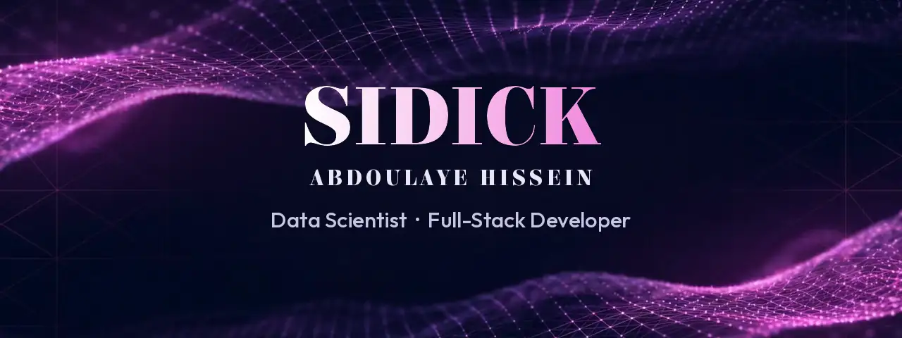
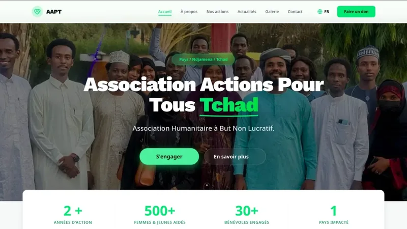
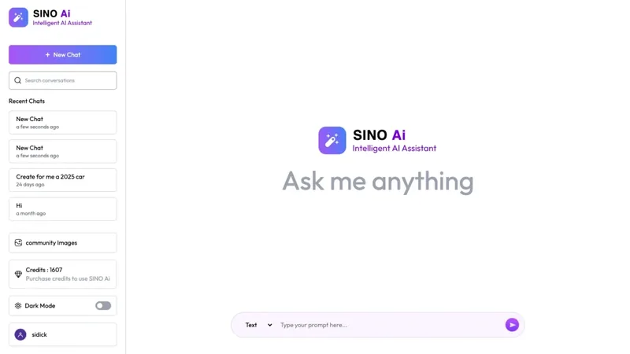
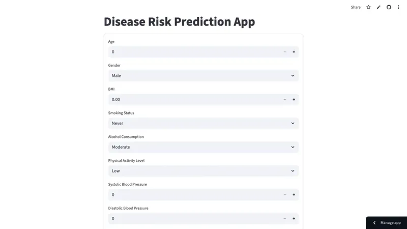
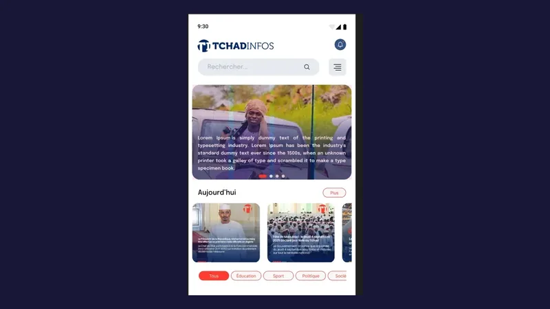
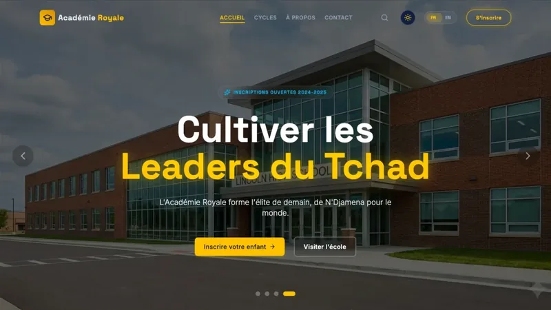
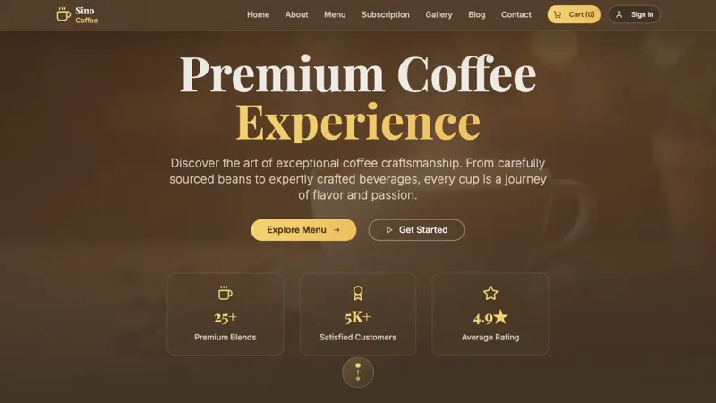

<a href="https://sidick.vercel.app">
  <picture>
    <source media="(prefers-reduced-motion: reduce)" srcset="assets/banner.png" />
    
  </picture>
</a>

  <a href="https://sidick.vercel.app"><strong>Portfolio</strong></a>
  &nbsp;&middot;&nbsp;
  <a href="https://www.linkedin.com/in/sidick-sino">LinkedIn</a>
  &nbsp;&middot;&nbsp;
  <a href="https://x.com/sinobour">X</a>
  &nbsp;&middot;&nbsp;
  <a href="mailto:sidickabdoulayesino1@gmail.com">Email</a>

I build web platforms, mobile apps and machine-learning tools, taking an idea from raw data and a rough design through to something people can actually use. I'm a Data Science student working between N'Djamena, Chad and Kigali, Rwanda.

My goal is to build digital products that genuinely serve students and entrepreneurs across Africa.

## Selected work

<table>
  <tr>
    <td width="50%" valign="top">
      
      
<strong>AAPT</strong>

      
Web platform for Association Actions Pour Tous Tchad, a non-profit working on social cohesion and community support.

      
React · Tailwind CSS · Supabase · i18next

      
<a href="https://aapt-eight.vercel.app/">Live site</a>

    </td>
    <td width="50%" valign="top">
      
      
<strong>Sino Ai</strong>

      
AI assistant web app with saved conversations, built on a Node.js and MongoDB backend.

      
React · Node.js · MongoDB · OpenAI API

      
<a href="https://sinoai-chi.vercel.app/">Live site</a> &nbsp;·&nbsp; <a href="https://github.com/sidicksino/sino_Ai">Code</a>

    </td>
  </tr>
  <tr>
    <td width="50%" valign="top">
      
      
<strong>Disease Risk Prediction</strong>

      
Machine-learning app that estimates disease risk from a person's health and lifestyle inputs.

      
Python · Scikit-learn · Pandas · Streamlit

      
<a href="https://sidicksino-disease-risk-prediction-app-aqgd49.streamlit.app/">Live app</a> &nbsp;·&nbsp; <a href="https://github.com/sidicksino/Disease-Risk-Prediction">Code</a>

    </td>
    <td width="50%" valign="top">
      
      
<strong>TchadInfos</strong>

      
Mobile news app for Chad, with stories browsable by category and a live news feed.

      
React Native · Expo · TypeScript · NewsData.io

      
<a href="https://github.com/sidicksino/tchadInfos_version1">Code</a>

    </td>
  </tr>
  <tr>
    <td width="50%" valign="top">
      
      
<strong>Académie Royale</strong>

      
Official website for an educational institution in N'Djamena.

      
React · Tailwind CSS · Supabase · i18next

      
<a href="https://school-rosy-nine.vercel.app/">Live site</a>

    </td>
    <td width="50%" valign="top">
      
      
<strong>SinoCoffee</strong>

      
Coffee brand site with a menu, subscriptions, a cart and user sign-in.

      
React · TypeScript · Supabase · Tailwind CSS

      
<a href="https://sino-coffee.vercel.app/">Live site</a> &nbsp;·&nbsp; <a href="https://github.com/sidicksino/SinoCoffee">Code</a>

    </td>
  </tr>
</table>

<a href="https://sidick.vercel.app"><strong>See all projects on my portfolio</strong></a>

## Stack

**Data science**

Also Pandas, NumPy, Matplotlib, Seaborn, Power BI and Tableau

**Frontend**

**Mobile and design**

React Native, Expo and Figma

**Backend**

## Activity

  <picture>
    <source media="(prefers-color-scheme: dark)" srcset="https://streak-stats.demolab.com?user=sidicksino&hide_border=true&background=00000000&ring=E748C8&fire=E748C8&currStreakLabel=E748C8&currStreakNum=F0F6FC&sideNums=F0F6FC&sideLabels=B8B6D4&dates=9C99BD&stroke=30363D" />
    
  </picture>

<picture>
  <source media="(prefers-color-scheme: dark)" srcset="https://raw.githubusercontent.com/sidicksino/sidicksino/output/snake-dark.svg" />
  
</picture>
